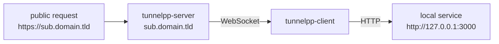

# tunnelpp

[](https://github.com/theo-dep/tunnelpp/actions/workflows/release.yml)
[](https://github.com/theo-dep/tunnelpp/releases/latest)
[](https://github.com/theo-dep/tunnelpp/pkgs/npm/tunnelpp)
[](https://github.com/theo-dep/tunnelpp/pkgs/container/tunnelpp)
[](LICENSE)

tunnelpp exposes a local HTTP service on a public subdomain through a tunnel server. The client opens an
outbound WebSocket to the server and forwards incoming requests to the local service. No inbound port, no
DNS record, no certificate to manage on the client side.



- **server** (`tunnelpp-server`): public HTTP listener, tunnel gateway, routing, admin API. Deployed with Docker.
- **client** (`tunnelpp-client`): CLI that connects to the server and forwards traffic to a local service.
  Also distributed as the npm package `@theo-dep/tunnelpp`.

## Quickstart

Run the server (TLS is terminated by a reverse proxy in front of it):

```sh
docker run -p 8080:8080 -p 127.0.0.1:8081:8081 \
    -e TUNNELPP_DOMAIN=tunnel.example.com \
    -e TUNNELPP_TOKEN=change-me \
    ghcr.io/theo-dep/tunnelpp:latest
```

Expose a local service:

```sh
npm install -g @theo-dep/tunnelpp
tunnelpp-client --server ws://tunnel.example.com/tunnel --token change-me --local http://127.0.0.1:3000
# tunnel ready: https://my-app.tunnel.example.com -> http://127.0.0.1:3000
```

## Documentation

The full documentation is in [`docs/`](docs/) and published with GitHub Pages:

- [Overview](docs/overview.md) — concepts and how a request flows through the tunnel
- [Architecture](docs/architecture.md) — components and threading model
- [Protocol](docs/protocol.md) — the WebSocket message format (v1)
- [Server](docs/server.md) — configuration and Docker deployment
- [Client](docs/client.md) — CLI usage and the npm package
- [Security](docs/security.md) — threat model and recommendations
- [Development](docs/development.md) — build, test, coverage, contributing
- [API reference](docs/api-reference.md) — admin API and protocol messages
- [Roadmap](docs/roadmap.md)

## Development

Requires CMake, Ninja, clang and a vcpkg checkout (`VCPKG_ROOT`):

```sh
just build-debug   # configure + build the server and the client
just test          # build and run the test suite (Debug + sanitizers)
just coverage      # build and run the tests with clang coverage instrumentation
just tidy <files>  # clang-tidy on changed files
just format <files> # clang-format on changed files
```

See [docs/development.md](docs/development.md) for details and [AGENTS.md](AGENTS.md) for the coding rules.

## License

[MIT](LICENSE)
