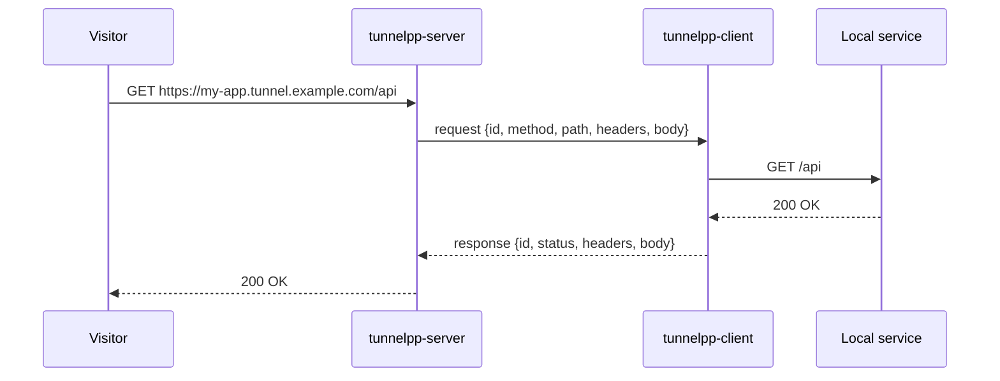

# Overview

## Concepts

- **Server**: the public entry point. It listens for HTTP requests on a public port and for tunnel
  connections (WebSocket) from clients. Deployed with Docker, usually behind a reverse proxy that terminates
  TLS.
- **Client**: a CLI running next to the local service. It connects outbound to the server and forwards the
  requests it receives to the local service.
- **Tunnel**: the WebSocket connection between one client and the server, registered on a subdomain.
- **Subdomain**: the public host name of a tunnel, `<subdomain>.<domain>`. It can be requested by the user
  (`--subdomain`) or generated randomly by the client.
- **Domain**: the base domain of the server, configured with `TUNNELPP_DOMAIN` (default `tunnelpp.local`).
- **Token**: a shared secret (`TUNNELPP_TOKEN`) required to register a tunnel.

## Life of a request

1. A visitor requests `https://my-app.tunnel.example.com/api` (TLS terminated by the reverse proxy, forwarded
   as plain HTTP to the server).
2. The server extracts `my-app` from the `Host` header and finds the tunnel registered on that subdomain.
3. The server sends a `request` message over the tunnel WebSocket, with a unique `id`.
4. The client forwards the request to the local service (`http://127.0.0.1:3000/api`), hop-by-hop headers
   stripped.
5. The client sends a `response` message with the same `id`, carrying the status, headers and body.
6. The server completes the pending request and returns the response to the visitor.

## Error mapping

| Situation | Public response |
| --------- | --------------- |
| No tunnel on the requested subdomain | `404` `{"error":"tunnel_not_found"}` |
| Tunnel connected but the client vanished mid-request | `502` `{"error":"bad_gateway"}` |
| Local service did not answer within `TUNNELPP_REQUEST_TIMEOUT` | `504` `{"error":"gateway_timeout"}` |
| Client cannot reach the local service | `502` `{"error":"bad_gateway"}` (from the client) |
