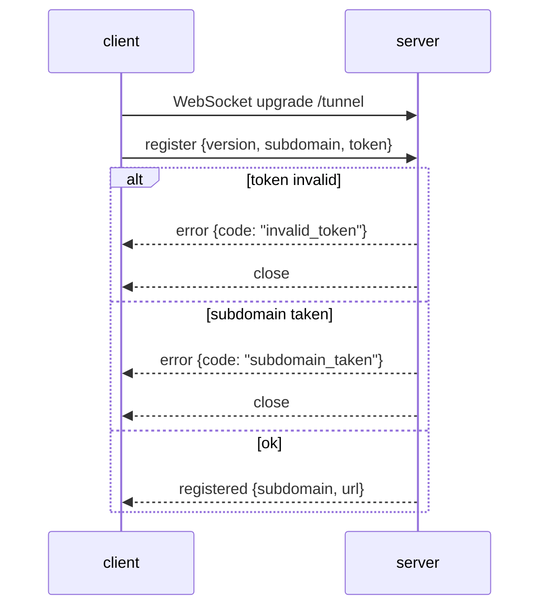

# Protocol

Tunnels are WebSocket connections (RFC 6455) between the client and the server, on the path `/tunnel` of the
public listener:

```
ws://tunnel.example.com/tunnel        (plain, e.g. local development)
wss://tunnel.example.com/tunnel       (TLS terminated by the reverse proxy)
```

All application messages are JSON text frames. Request and response bodies are base64-encoded in the
`body_b64` field. Headers are encoded as an array of `[name, value]` pairs, so duplicate headers (e.g.
`Set-Cookie`) survive the round-trip. The protocol version is `1` (`protocol_version` in `common/protocol.h`).

## Messages

### `register` — client → server

First message on a connection. Sent within 10 seconds of the WebSocket upgrade, otherwise the server closes
the connection.

```json
{
    "type": "register",
    "version": 1,
    "subdomain": "my-app",
    "token": "shared-secret"
}
```

`subdomain` must match `^[a-z0-9]([a-z0-9-]{1,61}[a-z0-9])?$` (3-63 lowercase letters, digits or hyphens).
The client generates a random subdomain when the user does not request one.

### `registered` — server → client

```json
{
    "type": "registered",
    "subdomain": "my-app",
    "url": "https://my-app.tunnel.example.com"
}
```

`url` is built from `TUNNELPP_PUBLIC_SCHEME`, the subdomain, `TUNNELPP_DOMAIN` and the public port.

### `request` — server → client

```json
{
    "type": "request",
    "id": "0192f4c2-1234-4abc-8def-0123456789ab",
    "method": "POST",
    "path": "/api/items?verbose=1",
    "headers": [["Content-Type", "application/json"], ["X-Custom", "yes"]],
    "body_b64": "eyJhIjoxfQ=="
}
```

Hop-by-hop and framing headers (`Host`, `Connection`, `Transfer-Encoding`, `Content-Length`, ...) are stripped
by the server before forwarding. The client must answer with a `response` carrying the same `id` within
`TUNNELPP_REQUEST_TIMEOUT` seconds (default 30).

### `response` — client → server

```json
{
    "type": "response",
    "id": "0192f4c2-1234-4abc-8def-0123456789ab",
    "status": 200,
    "headers": [["Content-Type", "application/json"], ["Set-Cookie", "a=1"], ["Set-Cookie", "b=2"]],
    "body_b64": "eyJpZCI6NH0="
}
```

When the local service cannot be reached, the client answers with `status: 502` and a JSON error body.

### `error` — both directions

```json
{
    "type": "error",
    "id": "0192f4c2-1234-4abc-8def-0123456789ab",
    "code": "invalid_token",
    "message": "invalid token"
}
```

`id` is empty for errors that are not tied to a request (registration phase). Codes:

| Code | Direction | Meaning |
| ---- | --------- | ------- |
| `invalid_token` | server → client | the register token does not match `TUNNELPP_TOKEN` |
| `invalid_subdomain` | server → client | the subdomain does not match the subdomain rules |
| `subdomain_taken` | server → client | another client is already registered on this subdomain |
| `unsupported_version` | server → client | the protocol version is not supported |
| `protocol_error` | both | unexpected message or message sequence |
| `bad_message` | server → client | the JSON could not be decoded |

Errors with `invalid_token`, `invalid_subdomain`, `unsupported_version` (or `subdomain_taken` for a
user-requested subdomain) are fatal for the client: it stops instead of retrying. `subdomain_taken` for an
auto-generated subdomain makes the client retry with a new random subdomain.

### `ping` / `pong` — both directions

```json
{ "type": "ping" }
```

Application-level keep-alive, in addition to the WebSocket protocol-level ping/pong handled by the HTTP
library.

## Registration sequence


